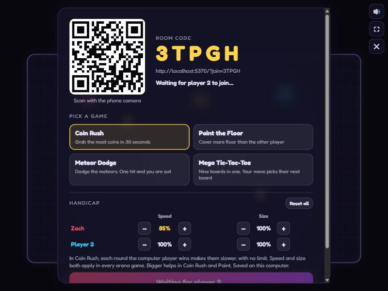
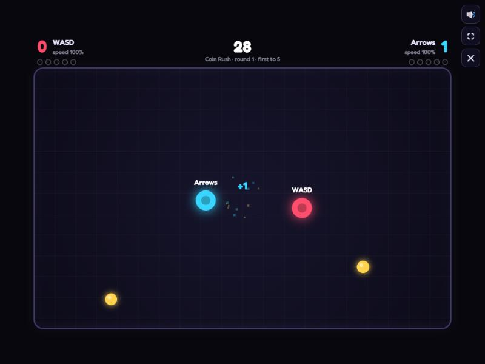
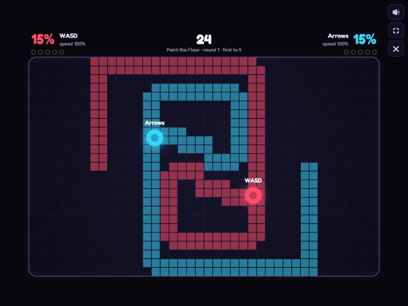
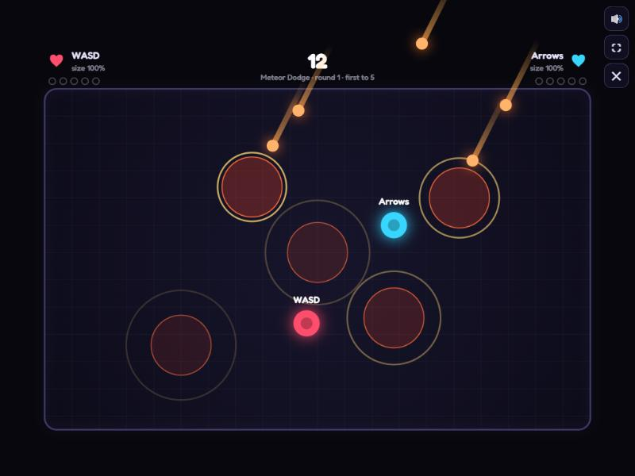
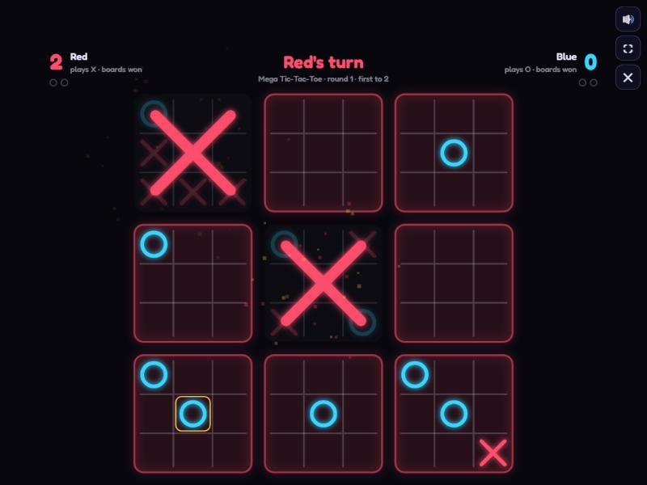

# Handicap Duel

**Status: playable and deployed.** Four games, and Zach and his sister have played it phone against computer. Balance is a first pass, and work continues as they play.

**Live:** https://handicap-duel.vercel.app (you need two devices: a computer to host and a phone to join)

A two-player party game built so a younger sibling can actually beat an older one. One player is on a computer and the other on a phone. Every round the computer player wins handicaps them a bit more, and every round the phone player wins takes some of that handicap back. Over a few matches the game settles where the weaker player wins about half the time.



## The games

| Game | Goal | What the handicap changes |
|---|---|---|
| **Coin Rush** | Grab the most coins in 30 seconds. Big orange coins are worth 3. | Speed ×0.92 per computer win |
| **Paint the Floor** | Your dot paints the floor tiles it touches, and you can paint over the other player's tiles. Own more floor after 30 seconds. | Speed ×0.92 per computer win |
| **Meteor Dodge** | Meteors land inside the warning circles. One hit and you're out. If you both survive 30 seconds, a meteor storm starts. | +16% size per computer win |
| **Mega Tic-Tac-Toe** | Nine boards in one. The square you play picks the board the other player has to use next. Win three small boards in a row. First to 2. | None (turn-based) |

| Coin Rush | Paint the Floor |
|---|---|
|  |  |
| **Meteor Dodge** | **Mega Tic-Tac-Toe** |
|  |  |

The screenshots come from the one-keyboard practice mode, which is why the players are named "WASD" and "Arrows" or "Red" and "Blue". The Meteor Dodge frame is staged: the meteors were placed by hand so several warnings show at once.

## How to play

1. On the computer, open the site, enter a name and click **Host a game**.
2. On the phone, scan the QR code, or open the site and type the 5-character room code.
3. On the computer, pick a game and click **Start match**. The arena games are first to 5 round wins. Mega Tic-Tac-Toe is first to 2.

**Controls**
- Computer: WASD or arrow keys. In tic-tac-toe, click.
- Phone: put a thumb anywhere and drag; the joystick follows your thumb. In tic-tac-toe, tap.
- **Practice on one keyboard** runs both players on one computer with no network.

**Rules worth knowing**
- **Arena games**
  - Bumping into the other player knocks you both back, which includes shoving them into a meteor.
  - A tie at the buzzer goes to sudden death: the next coin or tile wins.
  - In Meteor Dodge, about half the meteors aim at where a player is standing, alternating between the two players. If both players are hit at the same instant, nobody is out.
- **Mega Tic-Tac-Toe**
  - The computer player is red X and the phone player is blue O. The phone player moves first in round 1, then the first move alternates.
  - If you're sent to a board that is already won or full, you can play anywhere.
  - If the big board fills with no line, whoever won more small boards takes the round. If that's tied too, the round is replayed.

**The handicap**
- Each player has a speed and a size, and both start at 100%.
- A computer win first takes back any handicap on the phone player. If there's none, it handicaps the computer player one more step.
- A phone win takes back one step of the computer player's handicap. It never handicaps the phone player.
- There is no limit. Speed keeps shrinking by 8% of its current value and never reaches zero. Size keeps growing until the dot fills the arena from top to bottom.
- The host can also set speed and size for both players by hand in the lobby, including boosts such as making the phone player faster. Both stats apply in every arena game. Being bigger is an advantage in Coin Rush and Paint.
- The values are saved in the host computer's browser and carry over between matches and games.

## How it works

```
 Phone (guest)                         Computer (host)
 ─────────────                         ───────────────
 joystick / taps ── input 30×/s ──▶    runs the whole simulation
 renders snapshots ◀── state 30×/s ──  (game.ts, 120 Hz fixed step)
 (~50 ms behind, interpolated)
          └──── WebRTC data channel, peer to peer ────┘
     PeerJS public broker: only used to find each other by room code
```

- **No backend.** The site is static files on Vercel. The two browsers connect directly over WebRTC using [PeerJS](https://peerjs.com/).
- **The PeerJS dependency.** The free public PeerJS broker matches the 5-character room code to the host. If a direct connection can't be made, traffic falls back to PeerJS's public TURN relay. No account or API key is involved. If that broker is down, rooms can't open.
- **The host decides everything.**
  - Simulation, scoring and tic-tac-toe move validation all run on the computer.
  - The phone sends only stick input (about 30 times a second) or tic-tac-toe moves.
  - The phone renders the snapshots it receives, about 50 ms behind, smoothing player positions between them.
- **Code layout**
  - `src/game.ts`: simulation and rules for all four games.
  - `src/handicap.ts`: the handicap math.
  - `src/net.ts`: PeerJS host and guest links.
  - `src/render.ts`: Canvas 2D rendering with particles and screen shake.
  - `src/sound.ts`: procedural Web Audio sound effects; there are no audio files.
  - `src/main.ts`: screens, lobby and main loop.

### Run it locally

```bash
npm install
npm run dev        # http://127.0.0.1:5370
npm run dev:lan    # serve on your local network so a phone can join
npm test
npm run build
```

Dev builds expose a `window.__hd` hook that steps frames by hand. It's used to test in hidden browser tabs, which browsers pause.

### Deploy

The repo is connected to Vercel, so every push to `main` deploys to https://handicap-duel.vercel.app. A manual deploy also works with `vercel deploy --prod` from a linked checkout.

## Verification

- **Automated: 43 Vitest tests** (`tests/`)
  - Round flow, countdown, sudden death and match end.
  - Movement limits and wall clamping.
  - Bumps and coin pickup.
  - Paint ownership and stealing.
  - Meteor hits, near misses, the both-hit rule and the storm.
  - Every handicap rule: no limit, exact take-back, never slowing the guest, manual limits, loading old saves.
  - The full Mega Tic-Tac-Toe rules: legality, which board you're sent to, free choice, small-board and big-board wins, tiebreak and replay, alternating first move.
- **Checked by the AI agent in the browser**, with two tabs playing host and phone over a real PeerJS connection:
  - joining by code
  - phone input moving the guest
  - round end, handicap messages, rematch, disconnect and rejoin
  - the game picker, a meteor knockout, the paint grid syncing to the phone
  - tic-tac-toe taps from a phone-sized tab, and practice mode
  - the touch joystick, tested with synthetic touch events
  - the live site, connected the same way
- **Real devices:** Zach and his sister played the first version (Coin Rush) on a computer and a phone and reported it worked well. The later games have not been confirmed on real phones by a player.
- **Never tested:** iPhone versus Android differences, cellular networks (the TURN fallback path), and how the sound actually comes across.

## Known limitations

- Rooms depend on the public PeerJS broker. There's no fallback server.
- The host has slightly less input delay than the phone. The handicap absorbs this, but it isn't zero.
- If the host tab goes into the background, the game pauses because browsers throttle hidden tabs.
- iOS Safari doesn't support page fullscreen. Turning the phone sideways gives the biggest arena.
- On an upright phone, the scoreboard text in tic-tac-toe is small.
- Balance (meteor timing, paint coverage, the 8% and 16% steps) is a first pass that hasn't been tuned through repeated play.
- No accounts, saved history or online lobby. Players join only by code or link.

## Story

My sister wanted a game she could win, and I'm better than her at basically everything. Instead of me playing badly on purpose, the game holds me back: every round I win makes me slower or bigger, and her wins give it back. That way her wins are real.

It started as one coin-grab game over an afternoon. After we played it, I added Paint the Floor and Meteor Dodge, then lobby controls for every player's speed and size, then a turn-based Mega Tic-Tac-Toe mode where the handicap is switched off.

## AI assistance and Zach's role

This was built with heavy AI assistance. Claude (an AI coding agent) wrote essentially all of the code and tests, ran the browser verification and handled deployment.

Zach directed the project:
- He chose the self-balancing concept and wanted the two players to have the same role, not different ones.
- He picked which games to add and asked for the handicap to have no limit, with host controls for both stats.
- He chose phone against computer, and Vercel hosting.
- He playtested with his sister and gave the feedback that set the next steps.

One rule correction came out of review. The first version slowed the phone player when she won from an even start. That worked against the point of the game, so it was changed: only the computer player is ever handicapped automatically.

## Attribution

- [PeerJS](https://github.com/peers/peerjs) (MIT) and its public broker and TURN service, for WebRTC matchmaking.
- [node-qrcode](https://github.com/soldair/node-qrcode) (MIT), for the join QR code.
- [Fredoka](https://fonts.google.com/specimen/Fredoka) from Google Fonts (SIL Open Font License), loaded from Google Fonts.
- Built with Vite, TypeScript and Vitest. There are no third-party art or audio assets; all visuals are drawn in code and all sounds are generated.

## License

No license has been chosen. **All rights reserved; source is public to read.**
